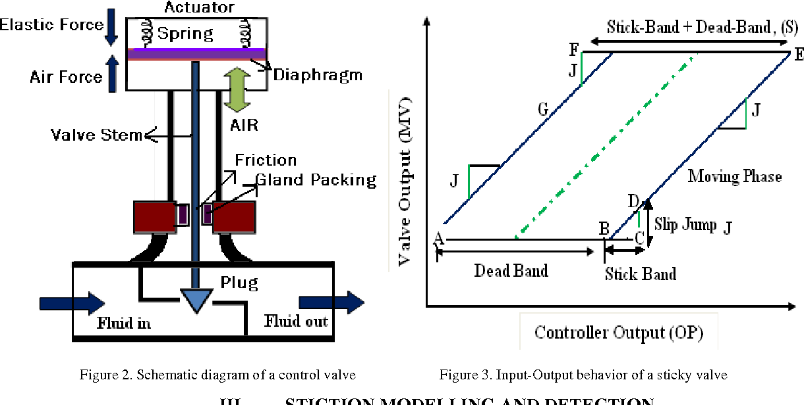

# Control Valve Stiction Implementation

大學專題：以 PV（製程變數）及 OP／CO（控制器輸出）實作控制閥黏滯偵測、量化，以及 SVR 對 Sigmoid R 指標的近似。

修復後已完成的實際驗證與結果見 [VALIDATION.md](VALIDATION.md)。

## 快速開始（Windows）

已建立本機 `.venv`。在專案資料夾執行：

```powershell
.\.venv\Scripts\python.exe run.py
```

預設 demo 使用隨附 MAT 資料完成小型 SVR 訓練、獨立測試及六種偵測方法，結果存到 `outputs/`。也可雙擊 `run_demo.cmd`。

第一次在其他電腦安裝時，使用 Python 3.11 或 3.12：

```powershell
python -m venv .venv
.\.venv\Scripts\python.exe -m pip install -r requirements-lock.txt
```

不需要 Poetry，也不需要手動啟用虛擬環境。`requirements.txt` 固定直接依賴版本；`requirements-lock.txt` 記錄驗證環境的全部套件版本。

## 執行實驗

```powershell
# Excel 主流程：七組訊號、全部可用完整視窗
.\.venv\Scripts\python.exe run.py train --source excel
.\.venv\Scripts\python.exe run.py test --source excel

# 指定其他 Excel；檔名會從 new_project/ 尋找
.\.venv\Scripts\python.exe run.py train --source excel --file "CVOP_20220201~0430.xlsx"

# 小型試跑：每個迴路、每個分區均勻選取最多 20 個視窗
.\.venv\Scripts\python.exe run.py train --source excel --max-windows 20

# 多組參數搜尋：只儲存驗證 MSE 最低的模型
.\.venv\Scripts\python.exe run.py train --source mat --c 0.1 1 2 --epsilon 0.01 0.1
.\.venv\Scripts\python.exe run.py test --source mat

# 四種統計法、線性迴歸、Sigmoid
.\.venv\Scripts\python.exe run.py detect --source mat --loops 2 3 --method all
.\.venv\Scripts\python.exe run.py detect --source flow
.\.venv\Scripts\python.exe run.py detect --source level

# 資料檢查、GIF、完整預測圖
.\.venv\Scripts\python.exe run.py inspect --source excel
.\.venv\Scripts\python.exe run.py gif
.\.venv\Scripts\python.exe run.py plot --source excel

# 回歸測試
.\.venv\Scripts\python.exe -m unittest discover -s tests -v
```

`--max-windows 0`（預設）使用所有完整視窗。大檔 Excel 的讀取和 Sigmoid 標籤擬合需要時間，程式會逐迴路／分區顯示進度。雙擊 `run_excel.cmd` 可依序執行完整 Excel 訓練與模型重載測試。

## 目前的運算定義

- 訊號依原始順序進行時間切分：70% 訓練、10% 驗證、20% 測試，三者沒有樣本交集。CSV 先依日期時間排序；隨附 Excel 原始資料按時間排列。
- 每個分區內每 60 點形成不重疊視窗，跨分區不取差分、不共用正規化統計量，尾端不完整視窗會記錄後略過。
- 每個視窗內：PV 一階差分後標準化，OP min-max 到 0～1。缺值與固定訊號視窗略過，原始索引保留，避免跨缺值拼接。
- 預設輸入為 60 個標準化差分 PV 與 60 個 OP，共 120 維；`--sample-step 3` 對應舊版的 40 維輸入。
- Sigmoid 類別接收已前處理的資料，擬合 `OP = sigmoid(a * delta_PV + b)`。R 為實際 OP 與擬合 OP 的 Pearson 相關係數，取到小數點後兩位，預設門檻 0.5。
- SVR 使用只在訓練資料 fit 的 StandardScaler 與 RBF 核心。參數選擇只看驗證集；測試集不用於訓練或參數選擇。每個視窗的標籤只擬合一次。
- 四種統計方法保留原專案的檢定家族。修正相鄰視窗陽性被覆蓋、雙尾 t 門檻、固定訊號與奇異矩陣處理；Method1 仍沿用原始單向變異數比判定，Method3 使用原式的一維化版本。這次修復沒有重新認證論文公式的一致性。
- 線性迴歸預設每 6 點擬合 PV／OP 的時間斜率，`abs(OP_slope/PV_slope) >= 15` 時標記。兩個斜率皆為零時不標記。
- 統計法量化輸出 OP band 第 95 百分位數；線性迴歸量化取最大 OP band。開頭、末端黏滯區段與沒有區段時均可處理。

R 是 Sigmoid 參考指標，SVR 的 MSE 是近似此指標的誤差；不能當作真實閥門黏滯標籤準確率、摩擦力量測或物理驗證。統計法的「未達顯著」也不代表已證明穩態。

## 輸出與舊檔

每次訓練建立新的 `outputs/<來源>_<時間>/`：

| 檔案 | 內容 |
|---|---|
| `model.joblib` | 模型、前處理版本、參數、資料分割設定、來源 SHA-256 |
| `report.json` | 訓練／驗證／測試 MSE、RMSE、MAE、常數基準、視窗涵蓋率與略過原因 |
| `parameter_search.csv` | 所有候選參數及驗證誤差 |
| `*_predictions.csv` | 迴路、分區、原始起終點、Sigmoid 參考 R、預測 R、誤差 |
| `*_predictions.png` | 所有保留視窗的完整結果，沒有按誤差篩選 |
| `evaluation/` | 載入模型後重新計算的獨立測試結果 |

`outputs/latest_<來源>.json` 指向該來源最後一次成功的模型。`test --model <完整路徑>` 可指定任一修復後模型；來源檔 SHA-256 改變時，程式會要求重新訓練。

`new_project/csv/` 中舊結果、舊 `.pkl` 模型、Excel／CSV／MAT 資料均保留。舊模型的特徵處理和套件版本不一致，修復後流程不自動載入它們。原本六張 Excel 結果圖也保留。

圖形預設使用無視窗的 Agg 後端存檔，腳本不會卡在 `plt.show()`。如需互動式繪圖，可在自己的 Python 程式設定互動後端後呼叫繪圖函式的 `show=True`。

## 程式結構與舊入口

```text
run.py                  統一 CLI
stiction/
  data.py               資料讀取、來源路徑、時間分割
  methods.py            六種偵測方法、Sigmoid、黏滯帶量化
  modeling.py           共用特徵流程、參數搜尋、儲存與測試
  plots.py              圖表存檔
  cli.py                執行各種實驗
  compat.py             原 Svr 類別的相容介面
tests/                  回歸測試
```

原 `svr_use.py`、`svr_use_new.py`、`svr_test.py`、`svr_test_new.py`、`LC_FC_training/FC.py`、`LC_FC_training/LC.py` 和 `new_project/` 下的 Python 檔名仍可執行，會導向統一流程。直接執行巢狀腳本時也可找到專案，import 不會讀取資料或啟動實驗。`tempCodeRunnerFile.py` 已改成有效的線性迴歸入口。

`Svr.train_valid(store=False)` 仍會建立新的完整實驗目錄，以保留可重現結果；只有 `store=True, store_path=...` 時才另外複製模型到指定位置。歷史拼字 `Linear_Rregression`、`Quantificatioin`、`perfrom()` 保留相容。

## 原專題參考文獻

1. S. K. Damarla, X. Sun, F. Xu, A. Shah, and B. Huang, "Statistical test-based practical methods for detection and quantification of stiction in control valves," Industrial & Engineering Chemistry Research, 2023, 62(12), 4410–4421.
2. S. K. Damarla, X. Sun, F. Xu, A. Shah, and B. Huang, "A Sigmoid Function based Method for Detection of Stiction in Control Valves," AdCONIP, 2022, 210–215.
3. S. K. Damarla, X. Sun, F. Xu, A. Shah, J. Amalraj, and B. Huang, "Practical linear regression-based method for detection and quantification of stiction in control valves," Industrial & Engineering Chemistry Research, 2022, 61(1), 502–514.


